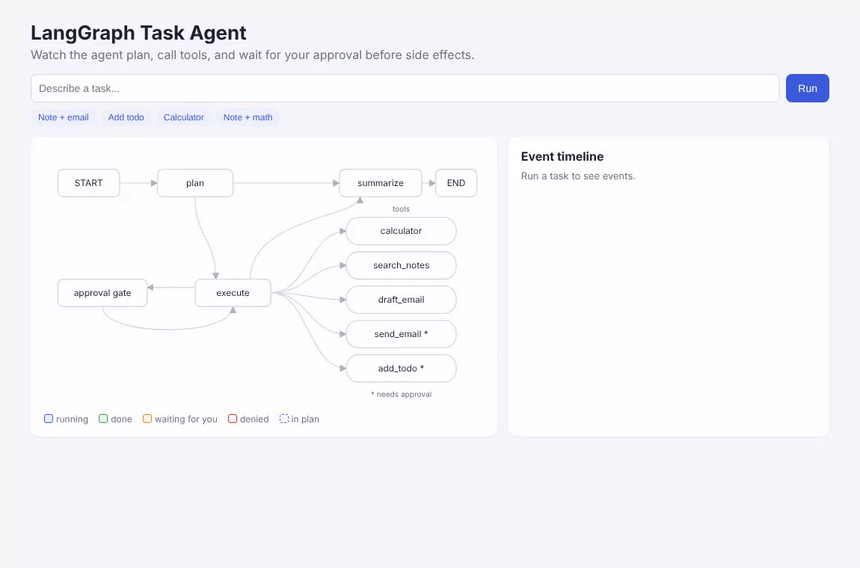
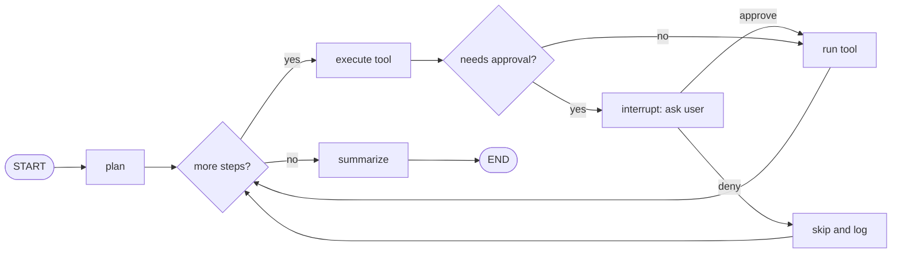
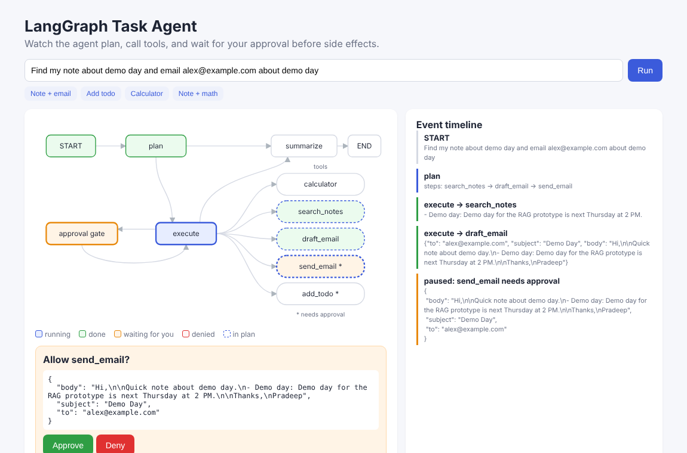

# LangGraph Task Agent

A small agent built with LangGraph that plans a task, calls tools step by step, and pauses for human approval before any action with side effects.

I built this to learn how LangGraph handles state, checkpointing, and human-in-the-loop interrupts.



**Stack:** Python, LangGraph, Flask, JavaScript (SVG), OpenAI API (optional), Docker, pytest, GitHub Actions

Note: the email and todo tools are mocked. They only write to local files.

## Graph



## Web UI: watch the agent coordinate

```bash
python -m agent.web      # http://localhost:8000
```

The page draws the graph and highlights each node as LangGraph streams it (`stream_mode="updates"`):

- **Blue:** node running
- **Green:** done
- **Orange:** paused at the approval gate, with Approve and Deny buttons
- **Red:** step denied
- **Dashed outline:** tool is part of the current plan

An event timeline on the right shows each step's input and output.



| Method | Endpoint | Body | Returns |
|---|---|---|---|
| POST | `/api/run` | `{"task": "..."}` | `thread_id`, ordered node events, pending approval |
| POST | `/api/resume` | `{"thread_id": "...", "decision": "yes" or "no"}` | remaining events and summary |

## CLI example

```
$ python -m agent.cli "Find my note about demo day and email alex@example.com about demo day"

Agent wants to run send_email with {'to': 'alex@example.com', 'subject': 'Demo Day', ...}
Approve? [y/N] y

Plan:
  1. search_notes
  2. draft_email
  3. send_email

Result:
search_notes: - Demo day: Demo day for the RAG prototype is next Thursday at 2 PM.
send_email: email to alex@example.com saved to outbox
```

Other tasks to try:

- `"what is 25 * 8 for the team lunch"` runs without approval
- `"add todo: book the demo room"` asks first; answer `n` and the step is skipped

## Tools

| Tool | Description | Needs approval |
|---|---|---|
| `calculator` | Arithmetic using AST parsing (no `eval`) | No |
| `search_notes` | Keyword search over `data/notes.json` | No |
| `draft_email` | Builds a `{to, subject, body}` draft | No |
| `send_email` | Appends to `data/outbox.jsonl` | Yes |
| `add_todo` | Appends to `data/todos.jsonl` | Yes |

## Implementation notes

- **Interrupts and checkpoints.** `interrupt()` pauses the graph and `MemorySaver` stores its state by `thread_id`. The run continues with `Command(resume="yes")` or `"no"`.
- **Passing results between steps.** `$prev` passes the previous tool's output forward. `$draft` sends exactly what `draft_email` produced, so the user approves the real payload.
- **Error handling.** A failing tool is recorded as a result and the run continues.
- **Planner.** With an API key, an LLM produces the plan as JSON. Without one, a rule-based planner is used, which also keeps the tests deterministic.

## Running locally

```bash
pip install -r requirements.txt
cp .env.example .env               # optional: add OPENAI_API_KEY
python -m agent.cli "your task here"
```

With Docker:

```bash
docker build -t task-agent .
docker run -it task-agent "what is 412 - 350"
```

## Tests

```bash
pytest -q
```

Tests cover calculator safety, plan structure, a run with no interrupt, the approve and deny paths, and the web API event stream.

## Possible improvements

- Use LLM tool calling (`bind_tools`) instead of JSON planning
- Persist checkpoints in SQLite or Postgres
- Retry failed steps

## Author

Pradeepreddy Annapareddy · [LinkedIn](https://linkedin.com/in/pradeepreddyar)
